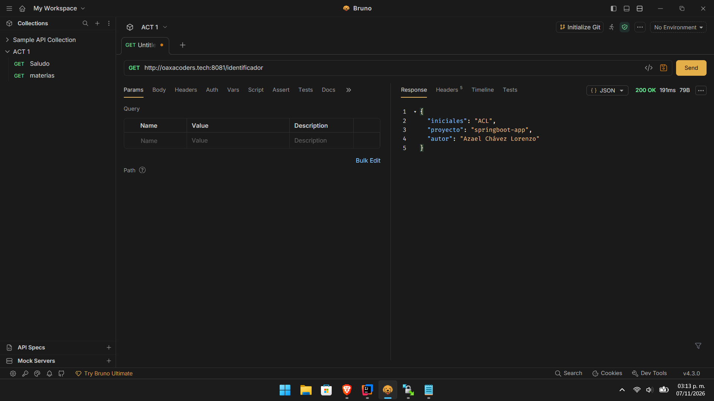
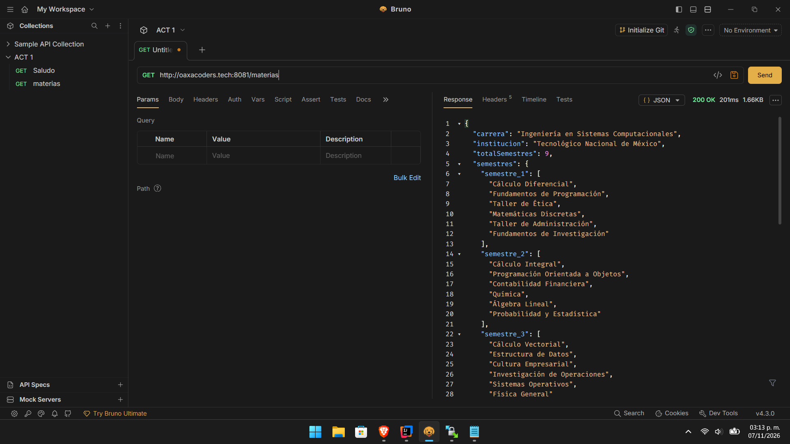
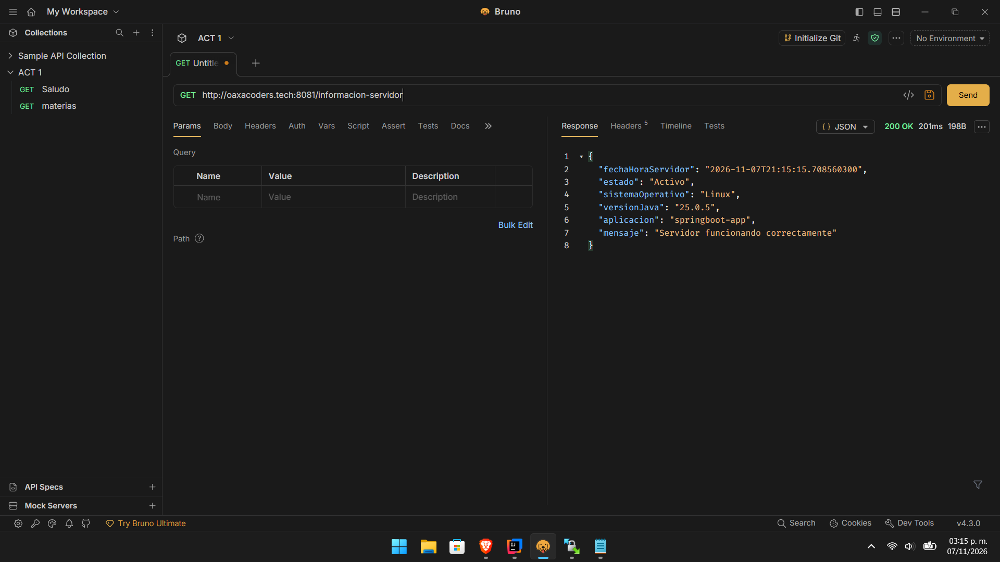

# Introducción a Spring Boot - Configuración y Primeros Controladores

## Descripción del proyecto

Este proyecto consiste en el desarrollo de una API REST básica utilizando **Spring Boot y Java**, con el propósito de comprender la configuración inicial del framework, la creación de controladores REST y la exposición de endpoints HTTP.

La aplicación permite consultar información académica, identificar el proyecto y obtener información general del servidor mediante respuestas en formato JSON y texto plano.

Además, la aplicación se encuentra preparada para su despliegue en un servidor VPS con Debian, utilizando Java y herramientas de administración de servicios.

## Tecnologías utilizadas

- **Java:** lenguaje de programación.
- **Spring Boot:** framework para desarrollar la aplicación REST.
- **Maven:** gestión de dependencias y compilación.
- **IntelliJ IDEA:** entorno de desarrollo.
- **Debian 12:** sistema operativo del servidor VPS.
- **Git y GitHub:** control de versiones y alojamiento del código.
- **SFTP:** transferencia del archivo JAR al servidor.

## Estructura del proyecto

```text
springboot-app/
├── src/
│   ├── main/
│   │   ├── java/com/progweb/springboot_app/
│   │   │   ├── SpringbootAppApplication.java
│   │   │   └── controllers/
│   │   │       ├── ControllerAcademico.java
│   │   │       └── ControllerMensajes.java
│   │   └── resources/
│   │       └── application.properties
│   └── test/
├── pom.xml
├── mvnw
├── mvnw.cmd
└── README.md
```

## Controladores y endpoints

La aplicación cuenta con dos controladores REST que permiten atender solicitudes HTTP mediante la anotación `@GetMapping`.

### 1. ControllerAcademico

Este controlador proporciona información de identificación y datos académicos.

**GET `/identificador`**

Devuelve un objeto JSON que contiene el nombre del proyecto, el autor y sus iniciales.

Ejemplo de respuesta:

```json
{
  "proyecto": "springboot-app",
  "autor": "Azael Chávez Lorenzo",
  "iniciales": "ACL"
}
```

**GET `/materias`**

Devuelve información académica simulada, organizada por semestres de la carrera de Ingeniería en Sistemas Computacionales.

La respuesta contiene el nombre de la carrera, la institución, el número de semestres y las materias correspondientes.

### 2. ControllerMensajes

Este controlador proporciona mensajes generales e información del entorno de ejecución.

**GET `/mensaje-simple`**

Devuelve un mensaje de bienvenida en texto plano.

```text
¡Bienvenido al servidor de Spring Boot configurado exitosamente!
```

**GET `/informacion-servidor`**

Devuelve un objeto JSON con información general de la aplicación y del entorno donde se ejecuta, incluyendo:

- Nombre de la aplicación.
- Estado descriptivo del servidor.
- Versión de Java.
- Sistema operativo.
- Fecha y hora del servidor.
- Mensaje de funcionamiento.

## Enlaces de los endpoints

La aplicación puede consultarse mediante las siguientes direcciones, utilizando el dominio configurado para el VPS.

| Endpoint | Enlace |
|---|---|
| Identificador | http://oaxacoders.tech:8081/identificador|
| Materias | http://oaxacoders.tech:8081/materias |
| Mensaje simple | http://oaxacoders.tech:8081/mensaje-simple |
| Información del servidor | http://oaxacoders.tech:8081/informacion-servidor|


## Capturas de pantalla

### 1. Endpoint de identificación



### 2. Endpoint de materias



### 3. Endpoint de mensaje simple


### 4. Endpoint de información del servidor



